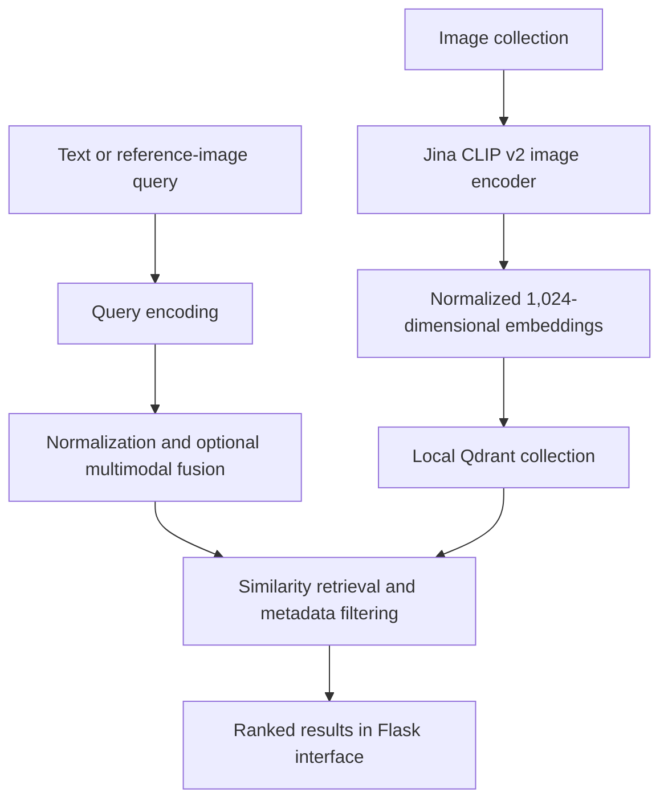

# Lens — Multimodal Image Retrieval

A local visual search application that combines natural-language queries, reference images, and structured metadata to retrieve images from a shared embedding space.

Built with **Jina CLIP v2 · Qdrant · Sentence Transformers · PyTorch · Flask**

## Overview

Lens supports three retrieval modes:

- **Text → Image:** Find images using natural-language descriptions.
- **Image → Image:** Retrieve visually similar images using a reference picture.
- **Image + Text → Image:** Combine visual and textual information into a single search query.

The application integrates embedding-based retrieval with manual-tag prioritization, metadata filtering, automatic tag suggestions, and a retrieval evaluation dashboard.

## Architecture



Image embeddings and metadata are persisted in Qdrant. Flask handles uploads, query processing, search controls, result rendering, and evaluation.

## Core Capabilities

### Multimodal Retrieval

Text and images are represented in a shared vector space using pretrained Jina CLIP v2 encoders.

For combined queries, Lens computes:

$$
q = \frac{v_{\text{image}} + v_{\text{text}}}
{\left\|v_{\text{image}} + v_{\text{text}}\right\|_2}
$$

Both input embeddings are normalized before fusion, giving the image and text equal weight.

### Metadata-Aware Ranking

- Prioritizes exact manual-tag matches during text search.
- Retrieves additional results by embedding similarity.
- Supports exact manual-tag or AI-tag filters.
- Exposes a configurable result limit of **1–20**.
- Applies a user-selected minimum cosine similarity.
- Displays similarity scores alongside retrieved images.

### Automatic Tag Suggestions

The image embedding is compared with text embeddings for a fixed vocabulary of **35 candidate labels**. The three highest-ranking labels are suggested as tags.

AI suggestions and manually supplied tags are stored separately, allowing users to distinguish their sources.

### Image Ingestion

- Supports JPG and PNG images.
- Validates image dimensions and request size.
- Applies EXIF orientation correction and RGB conversion.
- Uses content-hash filenames for web uploads.
- Stores image embeddings and metadata in Qdrant.
- Allows reference-image searches without adding the query image to the collection.

### Retrieval Evaluation

A dedicated dashboard evaluates semantic retrieval against user-selected relevance labels.

It reports:

- **Precision@5:** Relevant retrieved images divided by five result slots.
- **Recall@5:** Relevant retrieved images divided by all marked relevant images.
- **Search latency:** Query encoding and database retrieval time.
- **Per-result relevance and similarity scores.**

Evaluation runs are recorded locally in JSONL format for later analysis. Evaluation excludes manual-tag prioritization and search filters.

## Technology Stack

| Component | Technology |
|---|---|
| Multimodal encoder | Jina CLIP v2 |
| Embedding interface | Sentence Transformers |
| Inference framework | PyTorch |
| Vector storage | Qdrant local mode |
| Similarity measure | Cosine similarity |
| Backend | Flask |
| Image processing | Pillow |
| Interface | HTML, CSS, JavaScript |
| Evaluation storage | JSONL |

## Project Structure

| Path | Purpose |
|---|---|
| `flask_app.py` | Application routes, retrieval, ingestion, tagging, evaluation, and interface |
| `build_index.py` | Initial image embedding and index construction |
| `requirements.txt` | Python dependencies |
| `docs/EVALUATION.md` | Evaluation methodology and interpretation |
| `docs/CV_DESCRIPTION.md` | Concise project description |
| `.gitignore` | Excludes runtime data, environments, and model artifacts |

Runtime files are created locally:

- `images/` — image collection
- `image_store/` — persistent Qdrant database
- `evaluations.jsonl` — evaluation records

## Installation

Run these commands from the project directory in Windows PowerShell:

```powershell
python -m venv .venv
& ".\.venv\Scripts\python.exe" -m pip install -r requirements.txt
New-Item -ItemType Directory -Force images
```

Add at least one JPG or PNG image to `images/`, then initialize the index:

```powershell
& ".\.venv\Scripts\python.exe" build_index.py
```

Start the application:

```powershell
& ".\.venv\Scripts\python.exe" flask_app.py
```

Open **http://127.0.0.1:5000** after the server starts.

The first run downloads the pretrained model and requires internet access. Model loading uses `trust_remote_code=True`.

### Offline Operation

After the model has been cached:

```powershell
$env:HF_HUB_OFFLINE = "1"
& ".\.venv\Scripts\python.exe" flask_app.py
```

To allow downloads again:

```powershell
Remove-Item Env:HF_HUB_OFFLINE -ErrorAction SilentlyContinue
```

### Index Management

Initialize the index before using web uploads. Run the indexer and Flask application separately because they access the same local database.

After initialization, add images through the application. Rerunning `build_index.py` can overwrite existing tags because it writes path-only metadata.

## Example Queries

| Mode | Example |
|---|---|
| Text search | `a blue car beside a lake` |
| Reference-image search | Select a car photograph to retrieve similar images |
| Combined search | Select a reference image and add a descriptive text query |
| Filtered search | Search `butterfly` with an exact manual-tag filter |

Search retrieves existing images; it does not generate or edit them.

## Evaluation Snapshot

A small functional demonstration used **five indexed filenames representing three unique pictures**.

For the query `butterfly`, the two relevant butterfly files occupied ranks one and two.

| Metric | Observed result |
|---|---|
| Precision@5 | 40% |
| Recall@5 | 100% |
| Search latency | 1.631 seconds |

These measurements describe one demonstration query, not aggregate retrieval performance. Duplicate images and the small collection limit their usefulness as a benchmark.

See [evaluation methodology](docs/EVALUATION.md) for details.

## Validation

Functional demonstrations covered text, image, and combined retrieval, automatic tagging, filtering, and evaluation.

Additional backend integration checks used a temporary Qdrant database and a mocked encoder to validate search parameters, filtering, metric calculations, and input handling. These checks assess application behavior rather than pretrained-model quality.

## Current Scope

- Uses pretrained embeddings without training or fine-tuning.
- Runs inference on CPU with local storage and serial request processing.
- Provides a local application without authentication or multi-user isolation.
- Limits uploads to **16 MiB per request** and **24 megapixels per image**.
- Supports manual evaluation of up to **200 indexed filenames**.
- Treats similarity scores as ranking signals, not confidence probabilities.
- May return duplicate-looking images when identical content was indexed under different filenames.
- Uses a dependency list rather than a fully locked environment.

## Future Work

- Content-based deduplication across initial indexing and uploads.
- Evaluation on a larger, diverse collection with multiple labeled queries.
- Configurable image–text fusion weights.
- Batch ingestion and background indexing.
- Dependency locking and automated regression tests.
- Authentication and a server-backed database for multi-user deployment.

## References

- Pretrained model: `jinaai/jina-clip-v2`
- Initial tutorial reference: NeuralNine, *Image Search Engine in Python — Multimodal Embeddings*

The application extends the initial tutorial with image-based and combined-query retrieval, automatic tag suggestions, configurable filtering, evaluation logging, and a redesigned interface.